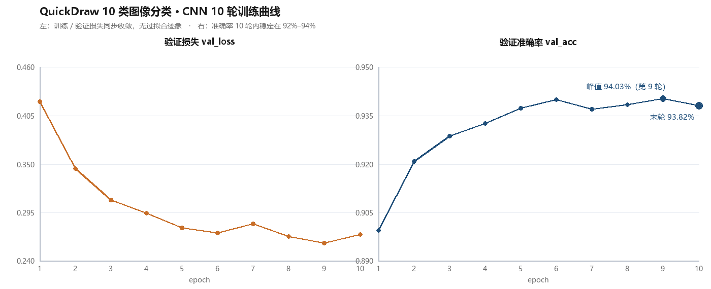

# QuickDraw 手绘草图识别（CNN / TensorFlow-Keras）

用 Google QuickDraw 的官方 `.npy` 数据训练一个 10 类手绘草图分类器，并用 OpenCV 对任意 28×28 灰度图做推理。

这是《人工智能开发框架应用》课程实训的个人独立作业，完整走完 **数据整合 → 预处理 → 建模训练 → 推理验证** 四步，四个 notebook 按编号顺序执行。

## 结果

| 指标 | 数值 |
| --- | --- |
| 类别数 | 10（apple / banana / bed / book / cup / door / foot / hamburger / key / sun） |
| 训练样本 | 80,000（每类取前 10,000 张，8:2 切分） |
| 测试样本 | 20,000 |
| 训练轮数 | 10 epoch，batch = 64 |
| 测试集准确率 | **93.82%**（最后一轮），第 9 轮峰值 **94.03%** |
| 训练耗时 | 单 epoch 约 5s（首轮 13s） |

10 个 epoch 的验证准确率变化：

```
Epoch  1  val_loss 0.4211  val_acc 0.8995
Epoch  3  val_loss 0.3095  val_acc 0.9287
Epoch  5  val_loss 0.2779  val_acc 0.9373
Epoch  7  val_loss 0.2826  val_acc 0.9370
Epoch  9  val_loss 0.2604  val_acc 0.9403   <- 峰值
Epoch 10  val_loss 0.2704  val_acc 0.9382
```



左图是训练 / 验证损失，右图是验证准确率；两条损失同步下降、没有出现验证损失回升，说明 10 轮之内还没有开始过拟合。

## 数据集

Google 官方发布的 QuickDraw 简化版数据按类别存为 `apple.npy`、`banana.npy`…… 每个文件形状 `(N, 784)`，即一张 28×28 的灰度图被展平成一维。

1. `1_dataAnalysis.ipynb` 用 `glob` 扫描 `./data/*.npy`，每类只取前 10,000 张（`data[0:10000, :]`）避免一次性吃爆内存；用文件名（去扩展名）作为类别名，按遍历顺序生成整数标签。
2. 用 `np.random.permutation` 打乱后按 8:2 切分，落盘为 `xTrain.npy` / `yTrain.npy` / `xTest.npy` / `yTest.npy`。

> 这里有个踩过的坑：拼接数组不能用 `np.array([])` 起手，空数组 dtype 是 float64，会导致后面 `.npy` 体积翻几倍。改用 `np.empty([0, 784])` 显式声明形状与 dtype。

3. `2_dataProcessing.ipynb` 把展平的 `(N, 784)` 还原成 `(N, 28, 28, 1)` 以适配卷积层，像素除以 255 归一化到 0~1，标签用 `to_categorical` 转 one-hot。

## 模型结构

`3_training.ipynb`，`keras.Sequential` 顺序堆叠：

```
Conv2D(16, 3×3, padding='same', relu)  ->  MaxPool2D(2×2)
Conv2D(32, 3×3, padding='same', relu)  ->  MaxPool2D(2×2)
Conv2D(64, 3×3, padding='same', relu)  ->  MaxPool2D(2×2)
Flatten()
Dense(128, relu, kernel_regularizer=l2(0.001))
Dropout(0.75)
Dense(10, softmax)
```

- `padding='same'` 让卷积后特征图尺寸不变，避免三轮卷积叠加 `valid` padding 后特征图过早缩没。
- 全连接层加 `l2(0.001)` 权重正则 + `Dropout(0.75)`，两处一起压制过拟合。
- 优化器 `Adam()`（默认学习率），损失 `categorical_crossentropy`，指标 `categorical_accuracy`。

训练数据管道：`tf.data.Dataset.from_tensor_slices` → `.batch(64)` → `.prefetch(AUTOTUNE)`，用预取隐藏数据加载延迟。同时挂 `tf.keras.callbacks.TensorBoard(log_dir='./logs/…', histogram_freq=1)` 记录每轮曲线与权重直方图，训练完可 `tensorboard --logdir=./logs` 查看。

模型存为 `./saved_model/model_quickdraw.h5`，类别名按字母序写入 `className.txt`。

## 推理

`4_predicting.ipynb` 用 `cv2.imread(path, cv2.IMREAD_GRAYSCALE)` 读图 → `cv2.resize` 到 28×28 → 除以 255 → `reshape(28,28,1)` → `expand_dims` 补 batch 维 → `model.predict` → `np.argmax` 取类别。

仓库里的 `samples/test1.png`、`samples/test2.png` 是实测样例，模型分别输出 `book` 与 `key`，与图片内容一致。

## 目录

```
1_dataAnalysis.ipynb     数据整合与 8:2 切分
2_dataProcessing.ipynb   reshape / 归一化 / one-hot
3_training.ipynb         建模型、训练、保存
4_predicting.ipynb       单图推理
className.txt            10 个类别名（按字母序）
saved_model/             训练好的 .h5 模型
samples/                 两张实测推理样图
docs/                    训练曲线图
```

## 运行

```bash
pip install tensorflow numpy opencv-python matplotlib tqdm
```

`./data/` 目录需要你自己放入 Google QuickDraw 的 `.npy` 文件（官方下载的 `quickdraw_simple` 数据集）。按 `1 → 2 → 3 → 4` 顺序执行 notebook，中间产物在 `./tmp/`。

## 可以继续改的地方

- 只有 10 类 × 1 万张，扩到 345 个官方类别时 `loadData` 的 `np.concatenate` 逐类拼接会明显变慢，可以改成先收集到 list 再一次性 `np.vstack`。
- `Dropout(0.75)` 偏高，配合 L2 后训练集准确率始终低于验证集（Epoch 10：0.9223 vs 0.9382），可以试试降到 0.5 看是否能再涨一点。
- 没有数据增强（随机平移 / 旋转），手绘图形变体多，加 `ImageDataGenerator` 或 `tf.keras.layers.RandomRotation` 大概率还能再提升。
